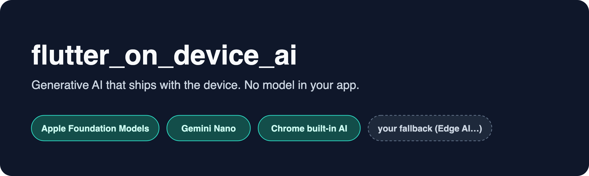
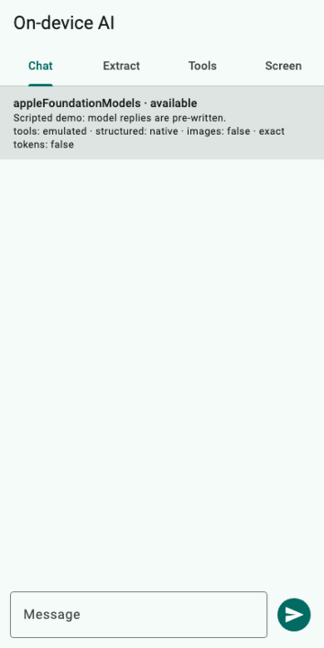
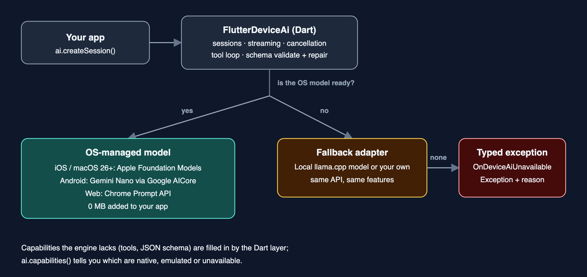

<p align="center">
  
</p>

<p align="center">
  <a href="https://pub.dev/packages/flutter_device_ai"></a>
  <a href="LICENSE"></a>
  
</p>

Your phone already contains a language model. Apple ships one with iOS and macOS 26, Google ships Gemini Nano through AICore on recent Android phones, and Chrome ships one in the browser. `flutter_device_ai` lets a Flutter app talk to **whichever one is present**, through a single API, and **hands over to a real open model that runs locally** (llama.cpp, downloaded once) when the device has none.

* Nothing to bundle: the OS models add **0 MB** to your app. The optional local fallback model is downloaded on first use (about 490 MB by default). No API key, no server, works offline.
* One API for chat sessions, streaming, cancellation, tool calling, JSON-schema output and generated UI.
* **A feature the engine lacks is filled in for you.** Tool calling and schema-constrained JSON work on every backend, natively where the OS supports them and through a tested Dart layer everywhere else. `capabilities()` tells you which is which.
* **Real fallback, not a stub.** Older phone, desktop, simulator, unsupported region: the same session code runs on a local open model (any GGUF, through llama.cpp).
* **Typed errors** that tell the user what to do (turn Apple Intelligence on, install AICore, tap to download).
* **Test without a device** using the bundled `FakeOnDeviceAiPlatform`.

```dart
final ai = FlutterDeviceAi();

if (await ai.isAvailable()) {
  final reply = await ai.generateText(prompt: 'Name three uses for a paperclip.');
  print(reply.text);
}
```

<p align="center">
  
  <br />
  <sub><b>Illustrative demo.</b> This is the real example app and the real library code (streaming, schema validation, tool loop, generated UI, embeddings and retrieval). The model's replies are pre-written and fed in through <code>FakeOnDeviceAiPlatform</code> (the Docs tab uses <code>FakeOnDeviceAiEmbedder</code>, so its match scores are not real embedding scores), so it shows the behaviour on a device whose OS model is ready, not a device capture or real model speed. On devices without an OS model the same screens run on the local fallback model, with a model picker in the status bar. Regenerate with <code>doc/demo.md</code>.</sub>
</p>

## Contents

[Install](#install) · [Pick an engine](#how-a-request-finds-its-engine) · [What works where](#what-works-where) · [Guide](#guide) · [Platform setup](#platform-setup) · [Errors](#errors) · [Testing](#testing-your-app) · [API map](#api-map) · [Limits](#known-limits) · [AI agents](#for-ai-coding-agents)

## Install

```sh
flutter pub add flutter_device_ai
```

Requires Flutter 3.38+ (Dart 3.10.7+). iOS 16.4+, macOS 14+, Android minSdk 26. Platform prerequisites are in [Platform setup](#platform-setup).

## How a request finds its engine

<p align="center"></p>

The decision is made per session, at the moment you create it, so a model that finishes downloading is picked up on the next session without restarting anything.

## What works where

`native` means the OS does it. `emulated` means this package does it on top of plain text generation, and it behaves the same everywhere. Ask the running device with `await ai.capabilities()` instead of testing for a platform name.

| | Apple (iOS / macOS 26+) | Android (API 26+) | Web (Chrome / Edge) | Fallback adapter | Windows / Linux |
|---|:---:|:---:|:---:|:---:|:---:|
| Text, streaming, cancel | native | native | native | via adapter | fallback only |
| Multi-turn sessions | native | kept in Dart | native | kept in Dart | fallback only |
| JSON-schema output | native | emulated, validated, auto-repaired | native | emulated | fallback only |
| Tool calling | native | emulated | emulated | emulated | fallback only |
| Image input | not yet | native | not yet | no | no |
| Token counting | estimate | exact | exact | estimate | estimate |
| Model download progress | OS-managed | yes | yes (needs a gesture) | your runner | your runner |

**Windows and Linux** have no OS-managed model this package can call, so they report `unavailable` and route to your fallback adapter. Native Windows AI support is on the roadmap.

> **Verification status.** The Dart layer is covered by unit tests, the web layer runs against a real browser engine with a stubbed `LanguageModel`, and the iOS, macOS and Android native code compiles against the real SDKs. Inference on a real Apple Intelligence or Gemini Nano device is exercised by `example/integration_test`, which you should run on your target hardware (see [Testing](#testing-your-app)).

## Guide

### Sessions: conversations with memory

```dart
final session = await ai.createSession(
  systemInstruction: 'You are a patient Dart tutor. Keep answers short.',
);

final first = await session.ask('What does `late` do?');
print(first.text);

final second = await session.ask('Show an example.'); // remembers the first turn
print(second.text);

print(await session.countTokens());
await session.close();
```

Open as many sessions as you like; they are isolated. A session answers one turn at a time and throws `OnDeviceAiSessionBusyException` if you touch it mid-generation.

A turn can be assembled from several parts before you ask for the answer:

```dart
await session.addQuery('Summarise this article:');
await session.addQuery(articleText);
final summary = await session.getResponse(config: const GenerationConfig(maxTokens: 200));
```

### Streaming and cancelling

```dart
final session = await ai.createSession();

final subscription = session.askStream('Write a long story.').listen(
  (delta) => setState(() => story += delta),
  onError: (e) => debugPrint('$e'),
);

// later, from a "Stop" button:
await session.stopGeneration();   // pending futures/streams fail with OnDeviceAiCancelledException
```

Cancelling is real: it stops the native generation, it does not just ignore the output.

### Structured output

Describe the shape you want with a JSON Schema. You always get either a value that satisfies it or an `OnDeviceAiStructuredOutputException`.

```dart
final res = await ai.generateText(
  prompt: 'Extract the person: "Ada Lovelace, mathematician, 36"',
  config: const GenerationConfig(
    responseFormat: ResponseFormat.json,
    schema: {
      'type': 'object',
      'properties': {
        'name': {'type': 'string'},
        'age': {'type': 'integer', 'minimum': 0},
      },
      'required': ['name', 'age'],
    },
  ),
);

print(res.json!['age']); // 36
```

Where the OS enforces the schema (Apple, Chrome) it is used directly. Everywhere else the package asks for JSON, extracts it from the reply (fences, chatter and truncated output included), validates it against your schema and, if it does not fit, **tells the model what was wrong and asks again** (`GenerationConfig.maxRepairAttempts`, default 2).

Supported schema keywords: `type` (object, array, string, integer, number, boolean, null), `enum`, `properties`, `required`, `additionalProperties: false`, `items`, `minItems`/`maxItems`, `minLength`/`maxLength`, `minimum`/`maximum`, `pattern`. Anything else fails fast with `OnDeviceAiSchemaException`, before any model runs.

With a schema, streaming delivers the validated answer as one chunk.

### Tools: let the model call your Dart code

```dart
final session = await ai.createSession(
  systemInstruction: 'You control a smart home.',
  tools: [
    OnDeviceAiTool(
      name: 'setThermostat',
      description: 'Sets the target temperature in Celsius.',
      parameters: const [
        ToolParameter(name: 'celsius', type: ToolArgumentType.number, description: 'Target in °C'),
        ToolParameter(name: 'room', type: ToolArgumentType.string, description: 'Room name', optional: true),
      ],
      onCall: (args) async {
        await home.setTemperature(args['celsius'] as num, room: args['room'] as String?);
        return {'ok': true};
      },
    ),
  ],
);

final reply = await session.ask('It is chilly, warm the living room to 22.');
```

* Nested or constrained arguments: pass `parameterSchema:` (a JSON Schema) instead of `parameters:`.
* Refuse or report a problem by throwing `OnDeviceAiToolException('Door is locked')`. The message goes back to the model as data so it can recover or explain.
* On Apple the OS calls your tool natively. Elsewhere the package teaches the model a small JSON protocol, validates the arguments against your schema, runs your function and feeds the result back, for up to `maxToolRounds` round trips. The loop also works while streaming.
* Small on-device models are less reliable at deciding *when* to call a tool than large cloud models. Keep descriptions specific and the tool list short.

### Fallback: keep working on devices with no OS model

`FlutterDeviceAi.withLocalModel()` runs a real open model on the device with llama.cpp (through [`llamadart`](https://pub.dev/packages/llamadart)) whenever the OS model is not ready. Sessions, streaming, tools and schemas all work the same. It runs on Android, iOS, macOS, Windows, Linux and the web, including the iOS simulator and Macs without Apple Intelligence.

```dart
final ai = FlutterDeviceAi.withLocalModel();

// Downloads the model once, only if the OS has none. Cached afterwards, then fully offline.
await ai.prepare(onProgress: (p) => print('${(p * 100).round()}%'));

final answer = await ai.generateText(prompt: 'Hello!');
```

* **Default model:** Qwen2.5 0.5B Instruct, Q4_K_M (about 490 MB). Pick a bigger one for better answers:

  ```dart
  FlutterDeviceAi.withLocalModel(
    model: 'hf://Qwen/Qwen2.5-1.5B-Instruct-GGUF/qwen2.5-1.5b-instruct-q4_k_m.gguf',
    contextSize: 4096,
  );
  ```
* **Models:** any GGUF chat model llama.cpp supports (Qwen, Gemma, Llama, Phi, SmolLM, Mistral and more) and `.litertlm` bundles. `model` is an `hf://owner/repo/file.gguf` source, an `https://` URL or a local file path. `LocalLlmFallbackAdapter.presets` lists checked models with sizes and the RAM they need; `LocalLlmFallbackAdapter.recommendedFor(ramGb)` picks one.
* **Quality:** conversations use the model's own chat template (the adapter receives structured `FallbackMessage`s, not a flattened prompt), and JSON-schema answers are grammar-constrained, so the output always parses. Tool calling is emulated in Dart with a worked example in the prompt; small models still miss tool calls more often than the OS models. Image input needs a vision model (see below).
* **Downloads:** resumable, with retries; pass `sha256:` to verify the file. `allowDownload: () async => onWifi` lets you refuse a download (for example on mobile data). `cancelPrepare()` aborts one. Failures (no network, no disk space) throw `OnDeviceAiUnavailableException`.
* **State and storage:** `adapter.status` streams `idle / downloading / loading / ready / unloaded` with progress. `isDownloaded()` and `deleteModel()` manage the cached file.
* **Memory:** `idleUnloadAfter: Duration(minutes: 5)` releases the model from RAM when unused; the next request reloads it from disk without downloading. `unload()` does it on demand.
* **Failover:** if the OS model reports it is unavailable while a session is running (for example Apple's model assets are missing), the session moves to the fallback and answers the turn there instead of failing.
* **Setup:** the plugin needs iOS 16.4+ and macOS 14+, and Swift Package Manager enabled in your app (`flutter config --enable-swift-package-manager`, or `flutter: config: enable-swift-package-manager: true` in your `pubspec.yaml`). Android adds the `INTERNET` permission for the download (the plugin declares it). A sandboxed macOS app needs the `com.apple.security.network.client` entitlement. On Android keep `armeabi-v7a` out of your ABIs.
* **Cost:** the llama.cpp runtime adds native libraries to your app on every platform even if the OS model is used.

**Images on the fallback.** Pass a vision GGUF with its projector (mmproj) and `session.addImage` works; `capabilities().imageInput` reports it:

```dart
final p = LocalLlmFallbackAdapter.visionPresets.first; // SmolVLM 500M
final ai = FlutterDeviceAi.withLocalModel(model: p.source, projector: p.projector);
await ai.prepare();
final s = await ai.createSession();
await s.addImage(pngBytes, mimeType: 'image/png');
print((await s.ask('What is in this picture?')).text);
```

For more control build the adapter yourself and pass it in:

```dart
final adapter = LocalLlmFallbackAdapter(
  model: LocalLlmFallbackAdapter.recommendedFor(6).source,
  idleUnloadAfter: const Duration(minutes: 5),
  allowDownload: () async => await isOnWifi(),
);
adapter.status.listen((s) => print('${s.phase.name} ${s.progress}'));
final ai = FlutterDeviceAi.withFallback(fallbackAdapter: adapter);
```

Need a different engine? Use `FlutterDeviceAi.withFallback(fallbackAdapter: ...)` with your own `OnDeviceAiFallbackAdapter`, or build one from callbacks with `CallbackFallbackAdapter(onGenerateText: ..., onGenerateStream: ..., isModelReady: ...)`. Adapters are stateless: the package keeps the conversation and passes the messages on each turn (override `generateChat` to use a model's chat template; the default renders a plain transcript).

### Embeddings and retrieval (RAG)

Search your own documents by meaning, offline. `LocalEmbedder` runs a GGUF embedding model with llama.cpp (default BGE small, about 36 MB, downloaded once).

```dart
final embedder = LocalEmbedder();
await embedder.prepare(onProgress: print);

final index = RagIndex(embedder: embedder);
await index.addDocument('manual', manualText); // chunks, embeds, stores

// Option 1: put the best passages in the prompt.
final context = await index.contextFor('how do I reset it?');
final answer = await ai.generateText(prompt: 'Using:\n$context\n\nHow do I reset it?');

// Option 2: let the model decide when to look things up.
final session = await ai.createSession(tools: [index.asTool()]);

// Persist: jsonEncode(index.toJson()) and RagIndex.fromJson(json, embedder: embedder).
```

Use the same embedding model for indexing and searching; mixing models throws on a dimension mismatch. Bring another engine by implementing `OnDeviceAiEmbedder`.

### Speech to text

`LocalSpeechToText` transcribes audio offline with Qwen3-ASR (about 1 GB download, clips up to roughly 30 seconds, mono 16 kHz works best).

```dart
final stt = LocalSpeechToText();
await stt.prepare(onProgress: print);
print(await stt.transcribeFile(path));
```

### Readiness, download and guidance

```dart
final state = await ai.availability();      // status + reason + a sentence for your UI
switch (state.reason) {
  case AvailabilityReason.ready:                 break;
  case AvailabilityReason.featureDisabled:       showHint('Turn on Apple Intelligence in Settings.');
  case AvailabilityReason.systemComponentMissing: await ai.openAICorePlayStore();
  case AvailabilityReason.modelNotReady:         await FlutterDeviceAi.ensureReady(onProgress: showProgress);
  default:                                       showHint(state.message);
}
```

`ensureReady` downloads the model when the platform allows it and reports progress from 0 to 1. **On the web call it from a click or tap**, otherwise the browser refuses and you get `OnDeviceAiUserActivationRequiredException`.

### Generated UI

Turn a goal into a typed, validated screen description and render it with your own widgets.

```dart
final generator = OnDeviceUiGenerator();
final module = await generator.generateModule(
  'A one-week plan to get ready for a 10K',
  language: 'English',
  principles: 'Calm, minimal, encouraging.',
);

if (module == null) {
  showHint(generator.lastError!);
} else {
  for (final block in module.blocks) { /* switch on block['type'] */ }
}
```

Block types: `stat`, `progress`, `checklist`, `list`, `steps`, `table`, `callout`, `note`. Blocks the model gets wrong are dropped, missing numbers get safe defaults, truncated JSON is repaired, and you only ever see blocks that are renderable. `module.toComponentMaps()` gives `{id, type, properties}` maps for component-based renderers. `GenUiBlockTypes.moduleSchema` and `OnDeviceUiGenerator.genUiInstructions` are public if you want to drive another engine. Pass `tools:` to let the model fetch data while it designs. The example app contains a complete block renderer.

## Platform setup

**Apple (iOS, macOS)**
The plugin builds for iOS 16.4+ / macOS 14+ (the llama.cpp fallback needs it) and the OS model needs 26. Inference needs **iOS or macOS 26+**, a device that supports Apple Intelligence, Apple Intelligence switched on in Settings, and **Xcode 26+** to build. Image input and exact token counts need newer SDKs and are not enabled yet.

**Android**
`minSdk 26`. Needs a device with Google AICore and Gemini Nano support (for example recent Pixel and Galaxy flagships). If AICore is missing, `availability().reason` is `systemComponentMissing`; call `openAICorePlayStore()`. If the model is not yet on the device, `ensureReady()` downloads it. Add `<uses-permission android:name="android.permission.INTERNET"/>` to your release manifest if you use the local fallback (the plugin declares it, Flutter's template only adds it for debug). The ML Kit GenAI Prompt API dependency (`com.google.mlkit:genai-prompt`) is added by the plugin; do not pin an older version.

**Web**
Desktop Chrome or Edge with the built-in Prompt API available (enable `chrome://flags/#prompt-api-for-gemini-nano` where it is not on by default). The first download needs a user gesture and several GB of disk. No build configuration needed.

**Windows, Linux**
No OS model is called yet. Provide a `fallbackAdapter`.

## Errors

Everything extends `OnDeviceAiException` and carries a stable `code`.

| Exception | Code | When |
|---|---|---|
| `OnDeviceAiUnavailableException` | `UNAVAILABLE` | No usable model and no fallback |
| `OnDeviceAiUnsupportedException` | `UNSUPPORTED` | Feature not offered (e.g. images on this backend) |
| `OnDeviceAiUserActivationRequiredException` | `USER_ACTIVATION_REQUIRED` | Web download outside a gesture |
| `OnDeviceAiSessionBusyException` | `SESSION_BUSY` | Session touched while generating |
| `OnDeviceAiCancelledException` | `CANCELLED` | `stopGeneration()` or a cancelled stream |
| `OnDeviceAiStructuredOutputException` | `STRUCTURED_OUTPUT_INVALID` | Schema not satisfied after repairs (`errors`, `rawText`) |
| `OnDeviceAiSchemaException` | `INVALID_SCHEMA` | Unsupported schema construct |
| `OnDeviceAiGenerationException` | `GENERATION_FAILED` | The engine failed |

## Testing your app

Swap in the in-memory platform. It keeps real session state, streams words as chunks and honours cancellation.

```dart
import 'package:flutter_device_ai/testing.dart';

setUp(() {
  FlutterDeviceAiPlatform.instance = FakeOnDeviceAiPlatform(
    responder: (prompt, transcript) => 'Echo: $prompt',
    // availability: ..., info: ... to simulate other devices
  );
});
```

To check the *real* model on your hardware, run the bundled integration test on a device that has one. It skips itself, with a printed reason, on devices that do not:

```sh
cd example
flutter test integration_test -d <device-id>
```

## API map

| You want to | Use |
|---|---|
| One question, one answer | `ai.generateText`, `ai.generateTextSimple` |
| Stream an answer | `ai.generateTextStream`, `session.askStream` |
| A conversation | `ai.createSession` → `ask`, `addQuery`, `addImage`, `getResponse`, `getResponseAsync`, `countTokens`, `stopGeneration`, `close` |
| Check readiness | `ai.availability`, `ai.isAvailable`, `ai.capabilities`, `ai.getPlatformInfo` |
| Prepare the model | `FlutterDeviceAi.ensureReady`, `ai.prepare`, `ai.downloadModel`, `ai.openAICorePlayStore` |
| Tune generation | `GenerationConfig` (`maxTokens`, `temperature`, `topP`, `topK`, `responseFormat`, `schema`, `maxRepairAttempts`) |
| Let the model act | `OnDeviceAiTool`, `ToolParameter`, `OnDeviceAiToolException` |
| Run on a local model when the OS has none | `FlutterDeviceAi.withLocalModel`, `LocalLlmFallbackAdapter` (`presets`, `recommendedFor`, `status`, `isDownloaded`, `deleteModel`, `unload`, `cancelPrepare`) |
| Search documents by meaning | `LocalEmbedder`, `RagIndex` (`asTool`, `contextFor`), `InMemoryVectorStore`, `OnDeviceAiEmbedder` |
| Transcribe audio offline | `LocalSpeechToText` |
| Run on your own engine | `OnDeviceAiFallbackAdapter`, `CallbackFallbackAdapter` |
| Build screens | `OnDeviceUiGenerator`, `GenUiModuleSpec`, `GenUiBlockTypes` |
| Parse model output yourself | `JsonSchema.validate`, `JsonExtractor.extract` |
| Test | `package:flutter_device_ai/testing.dart` |

Full API docs are on [pub.dev](https://pub.dev/documentation/flutter_device_ai/latest/).

## Known limits

* On-device models are small. Expect shorter context windows, simpler reasoning and occasional tool-calling misses compared with cloud models. Design prompts accordingly.
* `maxTokens` is honoured on Apple and Android; Chrome's Prompt API has no such limit and ignores it.
* Android's Prompt API is stateless, so long conversations are re-sent every turn and count against the model's context window.
* Chrome fixes sampling parameters when a session's model is created, so `temperature`/`topK` apply from the session's first turn.
* Image input works on Android and on the local fallback with a vision model; on Apple, image input needs an SDK that is not yet enabled here.
* Windows AI Foundry (Phi Silica) is not implemented yet.

## For AI coding agents

If you are an LLM or an agent working with this package, read [`llms.txt`](llms.txt) (usage and pitfalls) or [`AGENTS.md`](AGENTS.md) (repository guide for contributors).

## Contributing

Issues and pull requests are welcome. Run `flutter analyze`, `flutter test` and `flutter test --platform chrome test/web_test.dart` before opening a PR; see [`AGENTS.md`](AGENTS.md) for the architecture and the rules that keep the native layers honest.

## License

MIT. See [LICENSE](LICENSE).
