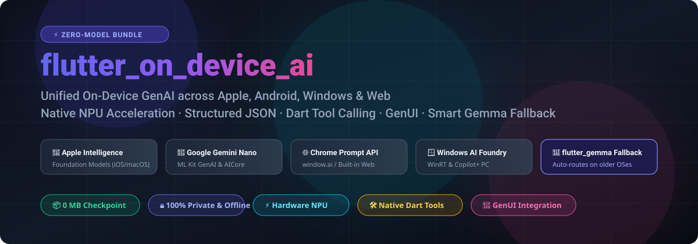

<p align="center">
  
</p>

<p align="center">
  <a href="https://pub.dev/packages/flutter_on_device_ai"></a>
  <a href="https://pub.dev/packages/flutter_on_device_ai/score"></a>
  <a href="https://github.com/seena98/flutter_on_device_ai/blob/main/LICENSE"></a>
  <a href="https://flutter.dev"></a>
</p>

<p align="center">
  <b>A unified, production-grade Flutter plugin for running on-device Generative AI using native OS-managed accelerators with zero app-bundled checkpoints, plus seamless fallback to <a href="https://pub.dev/packages/flutter_gemma">flutter_gemma</a>.</b>
</p>

---

## 🌟 Overview & Live Demo

`flutter_on_device_ai` bridges your Flutter applications directly to **Apple Foundation Models** (iOS 26+, macOS 26+), **Google Gemini Nano** via ML Kit GenAI & AICore (Android API 26+), **Chrome Built-in Prompt API** (`window.ai`), and **Windows AI Foundry** (WinRT) — with **0 MB** added to your app binary.

<p align="center">
  
</p>

---

## ✨ Unique Advantages

| Feature | `flutter_on_device_ai` | Standard Cloud APIs (OpenAI/Cloud Gemini) | Bundled Model Checkpoints |
| :--- | :---: | :---: | :---: |
| **App Download Size** | 🚀 **0 MB** (OS-managed) | 🚀 0 MB | ❌ 1.5 GB – 4.0 GB |
| **Privacy & Security** | 🔒 **100% On-Device** | ❌ Data leaves phone | 🔒 100% On-Device |
| **Offline Reliability** | ✈️ **Works in Airplane Mode** | ❌ Fails without Wi-Fi/LTE | ✈️ Works in Airplane Mode |
| **Inference Cost** | 💰 **$0.00 / Free Forever** | ❌ Monthly token billing | 💰 $0.00 / Free Forever |
| **Battery & Hardware** | ⚡ **Direct NPU Acceleration** | 🔋 Server side | ⚠️ High CPU/RAM overhead |
| **Smart Fallback Engine**| 💎 **Auto-routes to `flutter_gemma`** | ❌ None | ❌ Manual rewrite |

---

## 🏗️ Architecture & Platform Engines

```
┌────────────────────────────────────────────────────────────────────────┐
│                   flutter_on_device_ai (Public API)                    │
│   • One-Shot Facade (generateText, stream, genUI)                      │
│   • Stateful Session API (Multi-turn, Tool Calls, Cancellation)        │
│   • Smart Fallback Engine (Seamless flutter_gemma integration)         │
│   • Capabilities & Diagnostic Doctor (Token Count, Hardware Probe)     │
└───────────────────────────────────┬────────────────────────────────────┘
                                    │
               flutter_on_device_ai_platform_interface
        ┌───────────────────┬───────┴───────────┬───────────────────┐
        ▼                   ▼                   ▼                   ▼
   [ Android ]         [ Apple ]            [ Windows ]       [ Web (Chrome) ]
• ML Kit GenAI /     • Foundation Models   • Windows AI      • Prompt API
  Gemini Nano          (iOS/macOS 26+)       Foundry (WinRT)   (`window.ai`)
• AICore Resolver    • Tool Calling &      • Structured      • AbortController
  & Model Downloader   JSON Schema           JSON Output     • Streams & Quotas
        │                   │                   │                   │
        └───────────────────┼───────────────────┴───────────────────┘
                            ▼
              [ Pluggable Fallback Engine ]
        • flutter_gemma (MediaPipe / LiteRT-LM)
        • Bundled or dynamic downloaded models for older OSes (iOS < 26, older Android)
```

---

## 📊 Platform Support Matrix

| Feature | iOS / macOS (26+) | Android (API 26+) | Windows (11 25H2+) | Web (Chromium) | Linux / Older OS Fallback |
| :--- | :---: | :---: | :---: | :---: | :---: |
| **Text Generation** | ✅ Native Apple ANE | ✅ Gemini Nano | ✅ WinRT LanguageModel | ✅ `window.ai` | ✅ `flutter_gemma` |
| **Streaming Output** | ✅ Streamed Snapshots | ✅ StreamingCallback | ✅ Async WinRT | ✅ ReadableStream | ✅ Token Stream |
| **Structured Output**| ✅ Schema Enforced | ⚠️ Compile-time/Dart | ✅ Native WinRT JSON | ✅ `responseConstraint` | ✅ JSON Mode |
| **Tool Calling** | ✅ Bidirectional Dart | ⚠️ Dart Mediated | ⚠️ Emulated | ⚠️ Experimental | ✅ Dart Handlers |
| **Multi-turn Sessions**| ✅ Native | ✅ Native | ✅ Native | ✅ Native Quota | ✅ Stateful Transcript |
| **Generative UI (genUI)**| ✅ Typed Blocks | ✅ Typed Blocks | ✅ Typed Blocks | ✅ Typed Blocks | ✅ Typed Blocks |
| **Model Downloads** | ✅ OS-managed | ✅ Download Stream | ✅ System-managed | ✅ Browser Gesture | ✅ Model Downloader |
| **Token Counter** | ✅ OS 26.4+ Native | ✅ Native | ⚠️ Fast Estimator | ✅ `measureUsage` | ✅ Exact Tokenizer |
| **Cancellation** | ✅ AbortController | ✅ Cancellable | ✅ WinRT Cancel | ✅ AbortSignal | ✅ CancellationToken |

---

## 📦 Installation

Add `flutter_on_device_ai` to your `pubspec.yaml`:

```yaml
dependencies:
  flutter_on_device_ai: ^0.0.1
```

Or run:

```bash
flutter pub add flutter_on_device_ai
```

---

## 🚀 Quickstart Guide

### 1. Basic Generation (One-Shot)

```dart
import 'package:flutter_on_device_ai/flutter_on_device_ai.dart';

final ai = FlutterOnDeviceAi();

// Check device readiness
if (!await ai.isAvailable()) {
  print(await ai.availabilityReason());
  return;
}

// Generate text
final response = await ai.generateText(
  prompt: 'Explain quantum computing in two clear sentences.',
  config: const GenerationConfig(maxTokens: 200, temperature: 0.7),
);

print(response.text);
print('Latency: ${response.generationTimeMs}ms');
print('Tokens: ${response.tokenCount}');
```

---

### 2. Live Token Streaming

Stream decoded tokens live into your user interface as they decode:

```dart
final stream = ai.generateTextStream(
  prompt: 'Write an inspiring 3-line poem about space exploration.',
);

await for (final token in stream) {
  stdout.write(token);
}
```

---

### 3. Stateful Multi-Turn Conversations

Preserve conversation transcripts across turns using `OnDeviceAiSession`:

```dart
final session = await ai.createSession(
  systemInstruction: 'You are an intelligent code tutor. Be concise.',
);

// Turn 1
await session.addQuery('What is the difference between const and final in Dart?');
final reply1 = await session.getResponse();
print(reply1.text);

// Turn 2 (retains full chat context)
await session.addQuery('Can you give a code snippet illustrating this?');
await for (final chunk in session.getResponseAsync()) {
  stdout.write(chunk);
}

// Measure token count inside this session
final count = await session.countTokens();
print('Active context tokens: $count');

// Release native OS memory
await session.close();
```

---

### 4. Schema-Constrained Structured Outputs (JSON Mode)

Force the on-device model to output strictly valid JSON conforming to your JSON Schema:

```dart
final response = await ai.generateText(
  prompt: 'Extract profile from: "Elena Rostova, Principal Engineer, 9 years in ML & Systems"',
  config: const GenerationConfig(
    responseFormat: ResponseFormat.json,
    schema: {
      'type': 'object',
      'properties': {
        'fullName': {'type': 'string'},
        'role': {'type': 'string'},
        'yearsExperience': {'type': 'integer'},
        'specialties': {
          'type': 'array',
          'items': {'type': 'string'},
        },
      },
      'required': ['fullName', 'role', 'specialties'],
    },
  ),
);

// Direct access to decoded typed map:
final data = response.json;
print(data?['fullName']); // "Elena Rostova"
print(data?['role']);     // "Principal Engineer"
```

---

### 5. Native Dart Tool Calling (Function Calling)

Give the on-device model tools that trigger native Dart functions:

```dart
await ai.registerTools([
  OnDeviceAiTool(
    name: 'adjustRoomTemperature',
    description: 'Sets the smart thermostat temperature in Celsius.',
    parameters: const [
      ToolParameter(
        name: 'temperature',
        type: ToolArgumentType.number,
        description: 'Target temperature in Celsius (e.g. 21.5)',
      ),
      ToolParameter(
        name: 'room',
        type: ToolArgumentType.string,
        description: 'Room name (e.g. bedroom, living_room)',
        optional: true,
      ),
    ],
    onCall: (arguments) async {
      final temp = arguments['temperature'] as num;
      final room = arguments['room'] ?? 'living_room';
      
      // Perform hardware / API action in Flutter
      await SmartHomeClient.setTemperature(room: room, temp: temp.toDouble());
      
      return {'status': 'success', 'room': room, 'appliedTemp': temp};
    },
  ),
]);

// Prompting will autonomously trigger your Dart callback:
final reply = await ai.generateText(
  prompt: 'It is too chilly in the living room, please set it to 22 degrees.',
);
print(reply.text);
```

---

### 6. Smart Fallback with `flutter_gemma`

On older phones (iOS 15–18 or Android phones without Google AICore), connect `GemmaFallbackAdapter`. Your code runs without modification everywhere:

```dart
final ai = FlutterOnDeviceAi.withFallback(
  fallbackAdapter: GemmaFallbackAdapter(
    modelPath: 'assets/models/gemma-2b-it.bin',
    onGenerateText: (prompt, {config, instructions}) async {
      // Route through your flutter_gemma runner
      return await gemmaModel.generate(prompt);
    },
    onGenerateStream: (prompt, {config, instructions}) {
      return gemmaModel.generateStream(prompt);
    },
  ),
);

// Modern iPhone/Android -> Uses Apple Intelligence / Gemini Nano
// Older iPhone/Android -> Seamlessly executes via flutter_gemma!
final response = await ai.generateText(prompt: 'Hello world');
```

---

### 7. Generative UI (`genui` Integration)

Turn natural language goals into renderable typed-block modules:

```dart
final generator = OnDeviceUiGenerator();
final GenUiModuleSpec? spec = await generator.generateModule(
  'Create a 10K running prep tracker for this weekend',
);

if (spec != null) {
  print(spec.title); // "10K Running Prep"
  print(spec.blocks); // [{"type": "stat", ...}, {"type": "progress", ...}]
  
  // Directly feed A2UI surfaces or genui renderers:
  final componentMaps = spec.toComponentMaps();
}
```

---

## 🛠️ Platform Setup Guides

### 🤖 Android Setup
1. Requires Flutter 3.3.0+ and `minSdk = 26`.
2. Hardware compatibility: Google AICore must be installed. Compatible with Google Pixel 8+, Samsung Galaxy S24+, Xiaomi 14+, OnePlus 12+, and newer devices.
3. Handle AICore error code `-101` with one line:
```dart
if (await ai.getModelStatus() == ModelFeatureStatus.downloadable) {
  await ai.openAICorePlayStore(); // Deep links directly to Google AICore
}
```

### 🍎 Apple Setup (iOS & macOS)
1. Deployment floor: Compatible down to **iOS 13.0** and **macOS 12.0** (gracefully reports unavailable or uses `flutter_gemma`).
2. Native inference floor: Requires **iOS 26.0+** or **macOS 26.0+** with Apple Intelligence enabled on Apple Silicon (M1+ or A17 Pro+).
3. Build with Xcode 26+.

### 🪟 Windows Setup
1. Requires Windows 11 (25H2, build 26200.7309+) on a Copilot+ PC (NPU) or qualifying NVIDIA RTX / AMD Radeon GPU.
2. Built with the Windows App SDK WinRT projection.

### 🌐 Web (Chrome Prompt API) Setup
1. Run inside Chromium (Chrome Canary, Dev, or Edge) with:
   `chrome://flags/#prompt-api-for-gemini-nano` set to **Enabled**.
2. Requires user gesture for initial model download. Call `FlutterOnDeviceAi.ensureReady()` from a button click.

---

## 🩺 Diagnostic Doctor

Inspect hardware, download readiness, and backend capabilities at runtime:

```dart
final info = await ai.getPlatformInfo();
print('Active Backend: ${info.backend.name}');
print('Supports Tools: ${info.supportsToolCalling}');
print('Supports JSON:  ${info.supportsStructuredOutput}');
print('Supports Vision:${info.supportsVision}');

// Await preparation progress:
await FlutterOnDeviceAi.ensureReady(
  onProgress: (p) => print('Model downloading: ${(p * 100).toInt()}%'),
);
```

---

## 📄 License

This project is licensed under the MIT License — see the [LICENSE](LICENSE) file for details.
